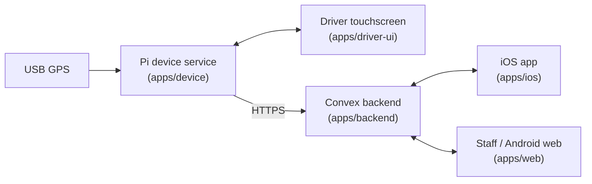

# ITSSB — Intelligence Transportation System for School Buses

An open-source school bus tracker: a Raspberry Pi on the bus reads GPS, a
backend checks who is allowed to see what, and students and guardians see where
their bus is and how fresh that information is.

> **Status:** early development (science fair project). The
> [specification](docs/README.md) is complete; the software is being built in
> the order described in the [roadmap](docs/15_BUILD_ROADMAP.md). Nothing here
> has been tested on a real bus route yet.

## How it fits together



| Path | What it is | Stack |
|---|---|---|
| `apps/backend` | Shared database, authorization, telemetry ingestion | Convex, TypeScript |
| `apps/device` | Runs on the bus Pi: GPSD reader, SQLite outbox, local API | Python, uv |
| `apps/driver-ui` | 7" touchscreen interface served by the device | TypeScript, Vite |
| `apps/ios` | Student/guardian app | SwiftUI, MapKit |
| `apps/web` | Staff console and family web for Android | TypeScript, Vite |
| `packages/contracts` | Shared wire types and fixtures | TypeScript |
| `packages/ui` | Shared web tokens/components | TypeScript |
| `docs/` | Full specification | Markdown |

## Hardware

Raspberry Pi 5 (2 GB) · Raspberry Pi Touch Display 2 (7") · SmartiPi Touch Pro 3
case · GlobalSat BU-353N5 USB GPS · official 27 W power supply. See
[hardware assembly](docs/02_HARDWARE_ASSEMBLY.md).

## Getting started

Prerequisites: [Bun](https://bun.sh) 1.4+, [uv](https://docs.astral.sh/uv/),
and for iOS a Mac with Xcode 26+, [XcodeGen](https://github.com/yonaskolb/XcodeGen)
and [SwiftLint](https://github.com/realm/SwiftLint).

```sh
bun install                 # JS/TS dependencies for every workspace
bun run check               # lint + typecheck + test (everything except iOS)

# Pi device service (tests run anywhere; live GPS needs GPSD + the receiver)
cd apps/device && uv sync && uv run pytest

# Backend: first run logs in to Convex and creates your own dev deployment
cd apps/backend && bunx convex dev

# iOS
cd apps/ios && cp Config/Secrets.example.xcconfig Config/Secrets.xcconfig
xcodegen && open ITSSB.xcodeproj
```

## Contributing

Read [CONTRIBUTING.md](CONTRIBUTING.md) and [AGENTS.md](AGENTS.md). This project
handles student location data, so please read [SECURITY.md](SECURITY.md) too.

## License

[MIT](LICENSE)
