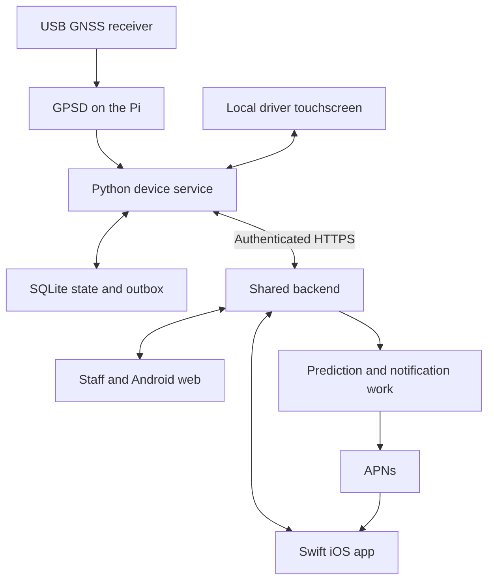

# I.T.S.S.B. — System architecture

**Intelligence Transportation System for School Buses**  
Status: recommended V1 architecture. [Documentation index](README.md).

## 1. The product's job

The product gives authorized students and guardians current transportation information, and gives drivers and school staff a manageable way to maintain it. It should answer where the assigned bus was last observed, when it is expected at the assigned stop, and whether a confirmed operational change affects the trip.

Information quality is part of the product. An old observation must retain its age. An estimate needs a generation time. A check-in needs a source. A reported delay needs an author or clearly identified inference. These rules make failures understandable instead of disguising them as successful live operation.

## 2. What runs on each machine

| Location | Installed or built there | Main data it owns |
|---|---|---|
| Bus Raspberry Pi | Raspberry Pi OS, GPSD, Python application, SQLite, local API, static touchscreen assets, Chromium kiosk | Local run recovery state, authorized route cache, unsent observations/actions |
| Developer's Mac | Xcode, Swift source, test fixtures, iOS dependency configuration | Application source and development settings; no production server signing secrets |
| iPhone | Signed I.T.S.S.B. app and permitted small caches | Current signed-in context, selected student/assignment, UI preferences |
| Backend environment | TypeScript functions, shared database, authorization, ingestion, prediction/notification orchestration | Approved assignments, canonical run state, accepted events, audit records |
| Staff/Android browser | Responsive web application | Current authorized view; minimal account-bound browser cache |
| Optional later model worker | Evaluated ETA model and deployment metadata | Controlled model artifacts and prediction jobs |

Do not install the Xcode project on the Pi. Do not place a database administration key in the Swift app. A browser page on the Pi is a local interface to its device service; a family browser page is an authenticated interface to the shared backend.

## 3. Connections and boundaries

The Pi, iPhone, and staff computer do not need the same network. Each uses its own internet connection to reach the backend. The local Pi API is bound to loopback. Publishing it on a public port is not part of this design.

External maps and internet connectivity are separate dependencies. A cached approved route polyline can still be drawn locally when map tiles are unavailable. Cached geometry does not make an online basemap into a licensed offline map product.

## 4. The daily operating sequence

### Before service exists

Staff create an organization, authorize drivers, pair a device with a bus, review a route version, and approve student assignments. Guardian access is a separate verified relationship. A newly created account has no implied permission to view a moving bus.

Routes can be recorded using the Pi or maintained by staff. The result is a draft until reviewed. Ordered stop placement and direction are explicit. Morning and afternoon may have different route geometry, stops, or student assignments.

### Before departure

The Pi starts its background service and graphical interface. The background service checks local state and reconnects to GPSD; the interface shows actual readiness. The driver unlocks an authorized session, selects an approved route, and confirms preflight.

For the first version, starting a new run requires online server authorization. The backend returns the run identity. The Pi commits that identity locally before continuing normal run operation. A repeated start request uses the same `requestId`, so a response lost on the network does not produce a second run.

### During travel

The GPS reader inspects usable observations at approximately one-second intervals. The application selects an outgoing cloud observation approximately every five seconds during an active run and writes that observation and its queue entry together. A separate route-recording mode can retain denser raw samples locally.

The uploader sends bounded requests and waits for explicit event outcomes. The backend updates history and current state according to the contract. The phone subscribes to compact authorized state. Approximately five-second publishing is an initial target; actual position age includes capture, network, processing, and client delivery.

### At a stop

Stop progression combines usable GPS, expected stop order, route position, speed when known, and dwell behavior. Arrival inference is independent of any student's attendance. The driver uses stopped-operation controls for the roster, QR challenge, or corrections. Complex controls remain unavailable while moving or when motion is unknown under the applicable guard policy.

### At completion

The driver confirms the intended run. The Pi saves an end event locally, submits it, and shows whether completion is only local or also synchronized. The backend retires active predictions and obsolete notification jobs for the completed run. The driver follows the school's physical procedures separately from digital completion.

## 5. Objects that must stay distinct

| Object | Example | Why the distinction matters |
|---|---|---|
| Route | Route 17 Morning | A reusable service definition |
| Route version | Route 17 Morning revision 3 | A fixed approved geometry and stop sequence |
| Run | One morning execution | Has actual start/end, driver, bus, and observations |
| Vehicle | Bus 12 | Can be replaced without changing the route's meaning |
| Device | One enrolled Pi | Can be replaced or reimaged without changing the vehicle record |
| Assignment | Student, route, stop, effective period | Grants transport access for a defined scope |
| Guardian link | Verified adult-to-student relationship | Grants visibility for that student only |
| Check-in | Student/run record with source | Describes a recorded claim or staff action |

Use opaque IDs returned by the relevant backend operation. Display numbers and names are labels, not authorization credentials. A run keeps its route version even if staff publish a different version for tomorrow.

## 6. Three independent states

Keep **operating state**, **position quality**, and **connection state** separate. An active run can have no current GPS fix. A valid GPS receiver can be collecting locally with no internet. A phone can have internet while the bus has stopped reporting.

The backend's normal run states are `scheduled`, `active`, `completed`, and `cancelled`. Delay is an operating attribute or report. It is not a replacement for these lifecycle states. Last-known position, current prediction, pending actions, and synchronization are separately represented.

Every client should derive its wording from these facts. A green Wi-Fi icon cannot establish cloud authorization, valid GPS, or successful upload.

## 7. Responsibility for truth

The Pi is the source of device observations, but the backend checks their identity and scope. The backend is the authority for approved assignments and shared records. The iPhone renders what its account is allowed to receive and sends requests for permitted actions. It does not approve itself or write the bus's position.

Convex provides authenticated identity inside backend functions; the application must use that identity to enforce its school, role, and assignment rules. See [Convex authentication in functions](https://docs.convex.dev/auth/functions-auth). The full authorization matrix is in [11_SECURITY_PRIVACY_AND_ACCESS.md](11_SECURITY_PRIVACY_AND_ACCESS.md).

When data is late, both capture time and receipt time matter. An observation captured before the current live point may be valid history while being ineligible to replace current state. The device outbox and the server's duplicate protection must agree about this. The authoritative field definitions are in [08_DATA_CONTRACTS_AND_API.md](08_DATA_CONTRACTS_AND_API.md).

## 8. Shared source organization

This is a proposed repository organization, not a claim that these applications are generated:

| Repository area | Contents |
|---|---|
| `docs/` | These Markdown guides and decisions |
| `device/` | Python package, local migrations, service template, configuration example |
| `driver-ui/` | Touchscreen source; built static assets are copied into the device release |
| `ios/` | Xcode project, Swift sources, app assets, tests |
| `backend/` | Convex functions, schema, indexes, auth integration, test fixtures |
| `web/` | Staff and family web interfaces |
| `contracts/` | Machine-readable schemas and canonical fixtures, when implemented |
| `model/` | Later baseline/model evaluation tools and versioned results |

Development dependencies stay on the development computer where possible. The Pi should run a built driver interface and the necessary runtime services. A production device does not need to build the website at every startup.

## 9. Scope boundaries

The purchase list supplies no independent cellular modem, vehicle power protection, backup battery, door sensor, seat-occupancy sensor, or emergency dispatch integration. Include new hardware only through an explicit integration decision. An AI estimate is measured against observed arrivals; an AI label does not establish accuracy.

Original requirements retained in this design include private name/address enrollment, eligible stop selection, driver seat notes, and the ability for an authorized driver to remove a student from their own route. These are defined in [09_ENROLLMENT_QR_AND_ATTENDANCE.md](09_ENROLLMENT_QR_AND_ATTENDANCE.md).

## 10. First acceptance milestone

One approved test route should show a real Pi GPS position on one authorized iPhone. Then demonstrate independent GPS loss, bus internet loss, phone internet loss, retry after an ambiguous response, restart recovery, and clean trip completion. Each failure should produce an understandable state and preserve the relevant records.

See the [roadmap](15_BUILD_ROADMAP.md) for build order and the [acceptance guide](13_TESTING_AND_ACCEPTANCE.md) for evidence to collect.

## Sources and related documents

- [Raspberry Pi kiosk tutorial](https://www.raspberrypi.com/tutorials/how-to-use-a-raspberry-pi-in-kiosk-mode/) — browser kiosk platform reference.
- [GPSD JSON protocol](https://gpsd.io/gpsd_json.html) — receiver report interpretation.
- [Convex Swift client](https://docs.convex.dev/client/swift/overview) — client subscriptions and calls.
- [Apple MapKit for SwiftUI](https://developer.apple.com/documentation/mapkit/mapkit-for-swiftui) — native map rendering.
- [Backend guide](07_BACKEND_AND_DATABASE.md), [Pi software](04_RASPBERRY_PI_SOFTWARE.md), [iOS guide](06_IOS_SWIFT_APP.md).

Platform sources describe capabilities. The product structure, naming, boundaries, and build milestones above are project design choices.
